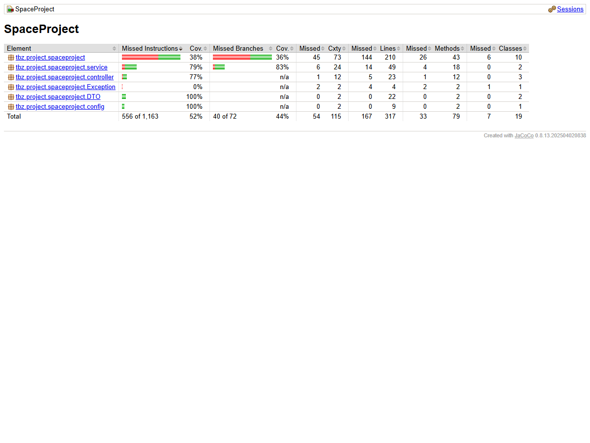
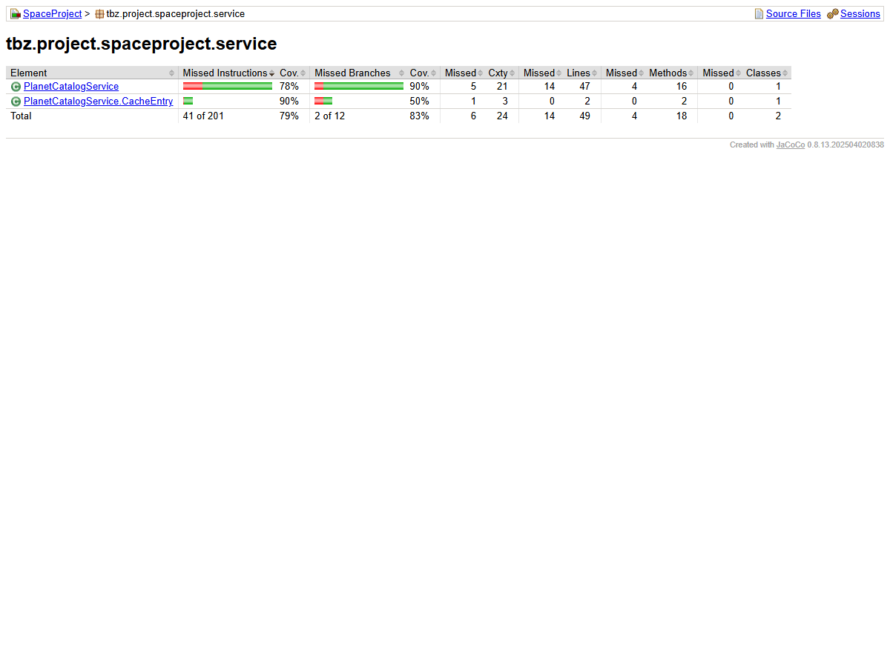

# Testkonzept für das SpaceProject

## Introduction

Das **SpaceProject** ist ein Full‑Stack‑System bestehend aus einem Spring‑Boot‑Backend (Java) und einem React/TypeScript‑Frontend.

---

##  Test Items 
| Ebene | Komponente | Beschreibung |
|-------|------------|--------------|
| **Backend** | `PlanetController`, `DestinationController` | REST‑API‑Endpunkte, Validierung, Fehlerbehandlung |
| **Backend** | Service‑Klassen (`PlanetService`, `PlanetCatalogService`, …) | Business‑Logik, Berechnungen, Ausnahme‑Handling |
| **Backend** | Repository‑Klassen | Datenbank‑Interaction (PostgreSQL) via Spring Data JPA |
| **Frontend** | React‑Komponenten (z. B. `PlanetListPage`, `PlanetDetailPage`, `SimulationPage`) | UI‑Darstellung, State‑Management, API‑Calls |
| **Frontend** | Utility‑Klassen (`useSpaceApi.ts`) | API‑Wrapper, Fehler‑Mapping |
| **Build / CI** | Gradle‑Tasks, npm‑Scripts | Build‑ und Test‑Ausführung, Code‑Coverage |
| **Datenbank** | PostgreSQL‑Schema (Tabellen `planet`, `destination`, …) | Persistenz‑Modell |

---

##  Features to be Tested / Not Tested
###  Features to be Tested
- CRUD‑Operationen für Planeten und Destinationen (GET, POST, PUT, DELETE)
- Business‑Logik: Berechnung der Schwerkraft, Volumen, etc.
- Validierung von Eingaben (z. B. Pflichtfelder, Werte‑bereiche)
- Fehler‑ und Exception‑Handling (HTTP‑Status‑Codes, Fehlermeldungen)
- UI‑Flows: Auflistung, Detail‑Ansicht, Simulation starten

### Features NOT to be Tested
- Third‑Party Services (z. B. externe Auth‑Provider) – werden durch Mock‑Stubs simuliert
- Browser‑Kompatibilität jenseits von Chrome/Edge (kein Cross‑Browser‑Testing)
- Infrastruktur‑Provisionierung (Terraform/Ansible) – wird von DevOps‑Team separat verifiziert
- UI‑Design‑Pixel‑Perfektion (visuelles Layout) – wird manuell von UI‑Designer geprüft

---

## Item Passed / Fail Criteria 
| Testobjekt | Pass‑Kriterium | Fail‑Kriterium |
|------------|----------------|----------------|
| API‑Endpunkt `GET /planets` | HTTP 200, JSON‑Array ≥ 1 Eintrag | anderer Statuscode, leeres Array |
| `PlanetService.calculateGravity` | Ergebnis innerhalb ±0.01 m/s² des erwarteten Werts | Abweichung > 0.01 m/s² oder Exception |
| UI‑Komponente `PlanetDetailPage` | Alle Planet‑Attribute werden korrekt angezeigt | Fehlende oder falsche Daten, JavaScript‑Fehler im Browser-Console log |
| Datenbank‑Constraint `planet.mass > 0` | Insert/Update mit negativer Masse wird abgelehnt (SQL‑Exception) | Daten werden gespeichert, Test‑Rollback fehlschlägt |

---

##  Approach
1. **Unit‑Tests** (White‑Box) – JUnit 5, Mockito, AssertJ für jede Service‑ und Repository‑Klasse.
2. **Integration‑Tests** – Spring Boot Test mit Testcontainers (PostgreSQL) für Controller + Service‑Kombination.
3. **End‑to‑End‑Tests** (Black‑Box) Playwright für UI‑Flows.
4. **Code‑Coverage** – JaCoCo, Mindest‑Schwelle 80 % Zeilen‑ und 70 % Branch‑Coverage.
5.**TDD**- 

---

##  Test Deliverables
- **Testplan**
- **Test Cases Specification** erwartetes Ergebnis, Priorität.
- **Test Scripts** – JUnit‑Klassen, Playwright‑Tests.
- **Test Reports** –JaCoCo‑Coverage‑Report.
- **Final Test Summary Report** – Zusammenfassung aller Ergebnisse, Abweichungen, Freigabe‑Entscheidung.

---

##  Environmental Needs 
| Umgebung | Beschreibung |
|----------|--------------|
| **Entwicklungs‑/Build‑Umgebung** | Windows 10, JDK 21, Node 20, Gradle 8, npm 10, Docker (für Testcontainers) |
| **CI‑Server** | GitHub Actions– führt `./gradlew test`, `npm test`, Playwright‑Tests |
| **Test‑Datenbank** | PostgreSQL 15 in Docker‑Container, initialisiertes Schema aus `src/main/resources/schema.sql` |
| **Browser‑Umgebung** | Chromium (Headless) für Playwright |
| **Test‑Reporting** |jococo für test coverage |

---

